# 코드 따라잡기 — 팀 저는님을돕기위해온사람입니다

<p align="center">
  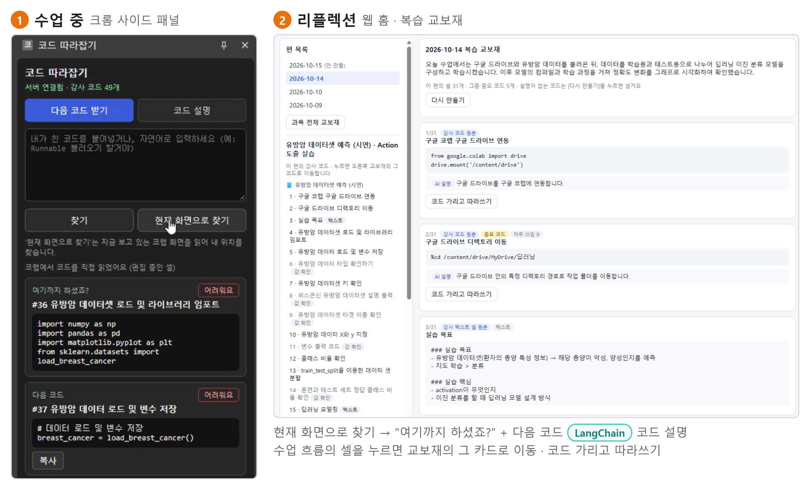
</p>

> 줌 수업의 강사 화면에서 코드를 셀 단위로 자동 수집해 두고, 흐름을 놓친 코딩 입문 수강생이 **자기 위치에서 다음 코드와 설명을 받아 다시 따라붙게** 하며, 데일리 리플렉션 시간에 **교보재·퀴즈로 복습**하게 하는 AI 교학 보조 서비스
> (PaddleOCR + LangChain·Gemini + FastAPI + 크롬 확장)

<!-- TODO: 시연 영상 링크(유튜브 등)를 올리면 12절에 넣기 -->

---

## 📋 1. 프로젝트 개요

- **과정**: 2026 K-Digital Training 지역산업연계 데이터 분석과정 1회차 (스마트인재개발원) 핵심 프로젝트
- **주제**: 실제 기업의 '고객 경험'을 AI로 개선하는 AX 서비스 — 대상 기관 = 스마트인재개발원, 고객 = 수강생
- **기간**: 2026.09 ~ 2026.10.16 (기획·데이터 분석 ~ 09.30 기획 발표, MVP 구현 10.01 ~ 10.16) <!-- TODO: 정확한 시작일 -->
- **배경 / 필요성**
  - 수업은 강사의 코드를 따라 치는 라이브 코딩 방식 → 타이핑하느라 설명을 놓치고, 한 번 놓치면 이후 수업을 따라가기 어렵다.
  - 설문(재학생 43명, 2026.09.10): **진도를 놓쳐 이후 이해가 어려웠던 적 76.7%**, 실습 중 강사 호출 경험 90.7%
  - 리뷰(수료생 강의 만족도 리뷰 263건): 불만·개선 요청 125건 중 **진도·속도 35.2%, 난이도·설명 방식 33.6%, 실습·오류 대응 20.8%**
  - 리뷰 원문: "타이핑하는데 바빠서 이해하기 너무 어려웠습니다 … 차라리 복붙을 하고 코드 설명을 좀 세세히 해주셨으면"
- **서비스 설명**
  - **수업 맥락 그대로의 정답**: 범용 AI가 만든 코드가 아니라, 그 수업 강사가 실제로 친 코드를 정답으로 준다.
  - **놓쳐도 스스로 복귀**: 강사를 부르지 않고 내 코드·현재 화면·자연어로 내 위치를 찾아 다음 코드를 받는다. 복사는 선택 기능(따라 칠 수 있으면 직접 친다).
  - **복습까지 연결**: 하루 수업 = 교보재 한 편, 퀴즈 3유형(객관식·서술·손코딩). 수업 중 [어려워요]를 누른 셀은 그날 퀴즈에 반드시 나온다.

## ⭐ 2. 주요 기능

| 구분 | 기능 | 설명 |
|---|---|---|
| 수집 (운영) | 강사 화면 자동 수집 | 화면을 0.5초마다 캡처(mss), 바뀐 뒤 2초간 그대로인 화면만 처리 |
| | 코드 셀 인식 | 셀 왼쪽 `[ ]` 실행 괄호·테두리·줄번호를 이미지 규칙(OpenCV)으로 찾아 셀 단위로 나눔, 들여쓰기는 글자 좌표로 계산 |
| | 글자 읽기·교정 | PaddleOCR(한국어 모델) → 여러 화면 판독을 줄마다 다수결 → **LangChain·Gemini가 OCR 오탈자만 교정** |
| | 3단계 검사 | 수정량(difflib 80% 이상 같음) · 줄 단위(OCR에 없던 코드 단어를 넣은 줄 거절) · 문법(ast) → 통과 못하면 '검수 필요' |
| | 완성 셀만 공개 | 실행됨 / 출력 있음 / 아래에 다음 셀 등장 중 하나일 때만 수강생에게 공개 (치다 만 코드 공개 방지) |
| | 운영 화면 | 수집 영역 지정, 수집 시작·중지·타이머, [새 수업 시작]으로 수업 구분, 셀 검수·직접 수정, 편(날짜)별 셀 보기 |
| 수업 중 (수강생) | 크롬 사이드 패널 — 다음 코드 받기 | ① 내 코드 붙여넣기 ② 현재 화면으로 찾기(코랩 글자 직접 읽기) ③ 자연어("Runnable 불러온 다음") → "여기까지 하셨죠?" + 다음 코드 |
| | 코드 설명 | 강사 설명이 있으면 우선, 없으면 'AI 설명' 표시 |
| | 어려워요 | 셀에 체크 → 그날 데일리 퀴즈에 우선 출제 |
| 리플렉션 (수강생) | 복습 교보재 | 하루 한 편(흐름 요약 + 그 편의 모든 셀 카드, 중요 코드 표시), 코드 가리고 따라쓰기, 과목 전체 교보재 |
| | 데일리 퀴즈 | 코드→기능 객관식 / 코드→기능 서술 / 기능→손코딩, 점수 없이 힌트 채점, [정답 보기]로 정답 확인 |

> 교보재·다음 코드에 나오는 코드는 **항상 DB 원본 그대로**이고, LLM은 셀 번호 선택·설명만 한다.

## 🛠 3. 기술 스택

| 구분 | 내용 |
|---|---|
| Language |     |
| Back-end |   |
| DB |  |
| OCR / Vision |    mss |
| LLM |   |
| 수강생 화면 | -4285F4?style=flat-square&logo=googlechrome&logoColor=white)  |
| 데이터 분석 |    Kiwi(형태소 분석), gensim/LDA, pyLDAvis |
| IDE / Tool | VS Code, Jupyter, Google Colab, GitHub |

## 🏗 4. 시스템 아키텍처

<p align="center">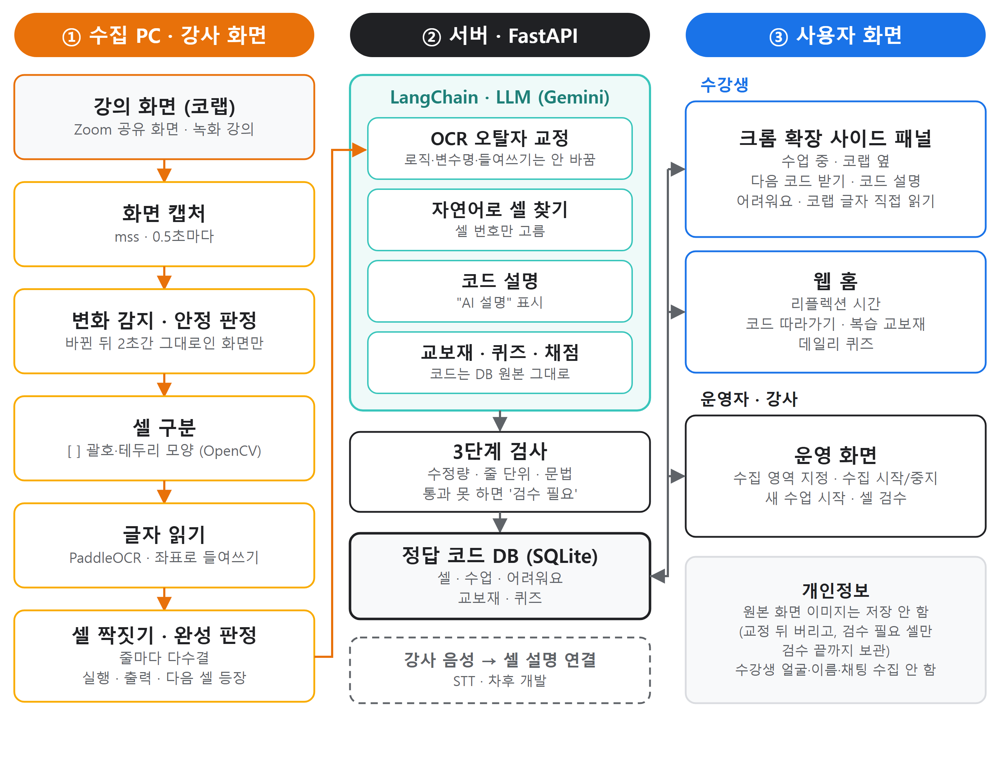</p>

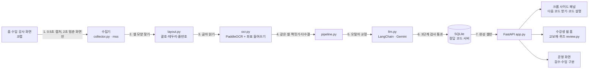

1. 수집 PC가 강사 화면(코랩)을 0.5초마다 캡처하고, 바뀐 뒤 2초간 그대로인 화면만 넘긴다.
2. 셀 왼쪽 `[ ]` 괄호와 테두리로 코드 셀을 나누고, 3. PaddleOCR로 글자를, 글자 좌표로 들여쓰기를 구한다.
4. 여러 화면에서 읽은 같은 셀을 짝지어 줄마다 다수결로 정하고, 5. LLM이 OCR 오탈자만 교정한다.
6. 수정량·줄 단위·문법 검사를 통과하면 저장, 아니면 '검수 필요'로 운영자에게 보낸다. 원본 화면 이미지는 저장하지 않는다.
7. 완성된 셀만 사이드 패널·웹 홈에 공개된다.

## 👤 5. 유스케이스

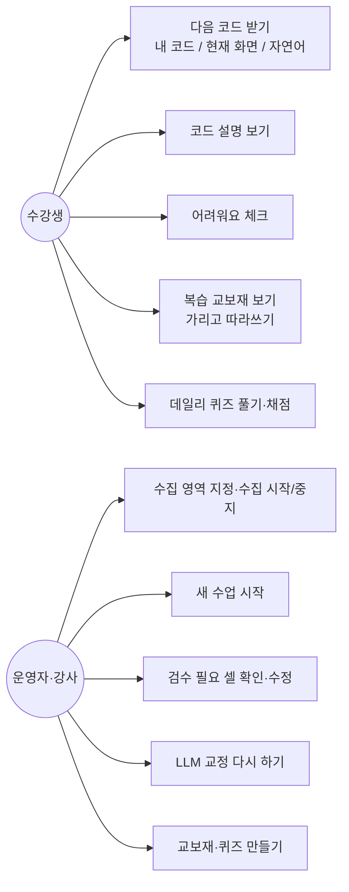

## 🔀 6. 서비스 흐름도 — 다음 코드 받기

<p align="center">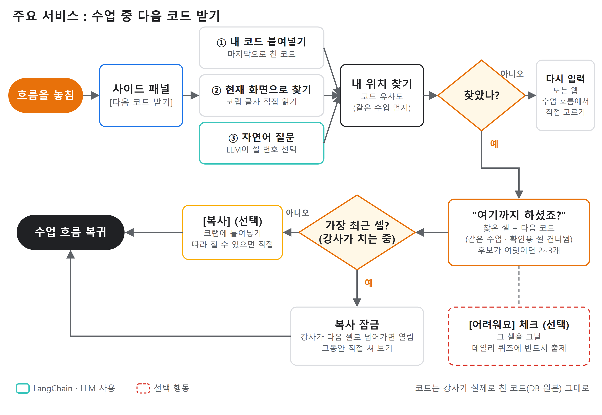</p>

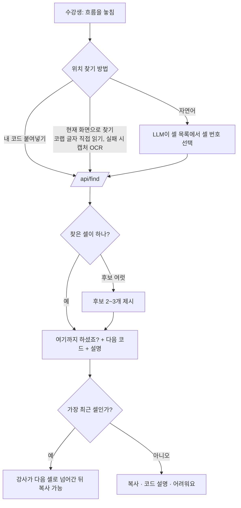

## 🗂 7. ER 다이어그램

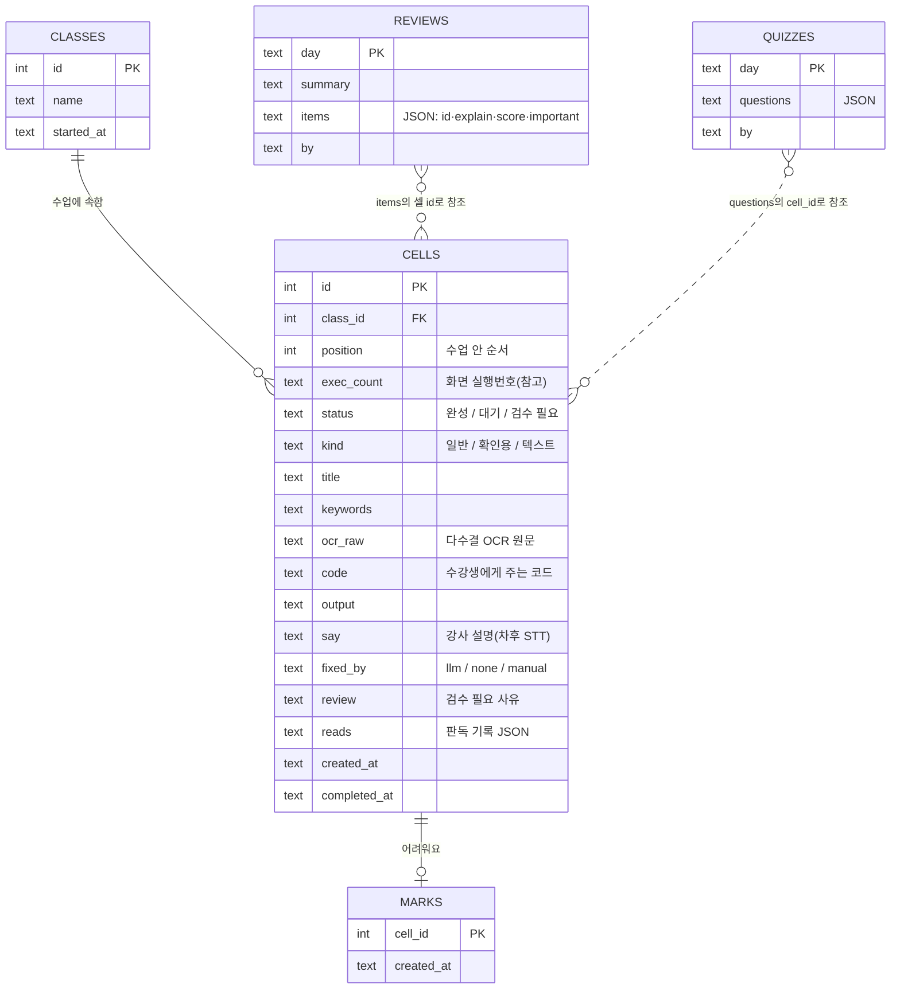

> 셀 번호(실행번호)는 다시 실행하면 바뀌므로, 서버가 고정 `id`와 화면 순서 `position`을 따로 저장한다. 교보재·퀴즈는 코드를 복사해 두지 않고 셀 id만 저장한다(코드는 항상 `cells`에서).

## 🤖 8. 데이터 분석 · 모델 구현

### 8-1. 수강생 불편 분석 (`강의리뷰 분석/01~03 노트북`)

| 데이터 | 규모 | 방법 | 결과 |
|---|---|---|---|
| 수료생 강의 만족도 리뷰 | 265건 → 263건(중복 2건 제거) | 규칙 사전 감성·9유형 태깅 + 전수 검수 | 불만·개선 요청 125건(47.5%), 규칙 태깅 정확도 88.8% |
| 〃 불만 문장 | 112건 × 단어 77개 | Kiwi 형태소 → TF-IDF → LDA (30 seed 반복, 재현 토픽만 사용) | 3토픽: 타이핑·읽기식 진행에 설명을 놓침 / 속도·기간 / 이론 위주라 실습 어려움 → 규칙 분류 상위 3유형과 대응 |
| 재학생 학습 경험 설문 | 43명, 11문항 | 교차분석, 계층적 군집(Ward) | '따라가기 벅찬 입문자' 18명(코딩 처음 83.3%·타자 느림 38.9%·입력이 느려 진도 놓침 55.6%) — 연령보다 코딩 경험·타자 속도가 가름 (실루엣 0.20, 구조는 약함) |

<p align="center">
  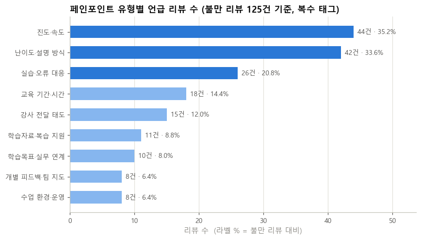
  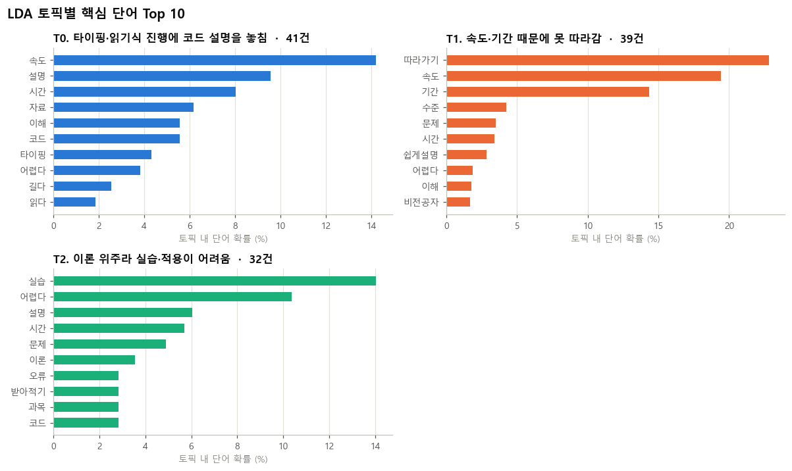
  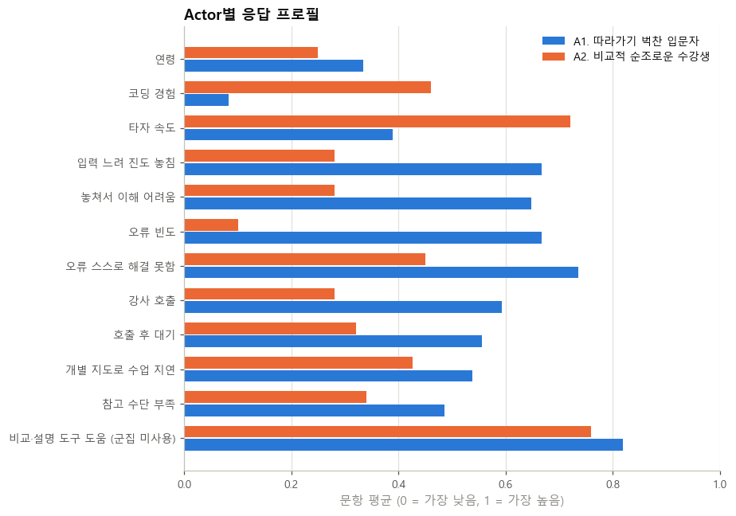
</p>

- **seed 하나를 고르지 않았다**: seed만 바꿔도 토픽이 달라져(시드 간 안정성 약 0.42) 30번 학습 후 반복해서 나오는 토픽만 남겼다. 이전 버전(seed=42)의 '자료·복습 지원 부족' 토픽은 재현율 3/10이라 버렸다.
- 리뷰(수료생)와 설문(재학생)은 다른 사람이라 합치지 않고 각각 근거로만 썼다.

### 8-2. 화면 → 코드 인식 시안 비교 (시제품)

| 시안 | 구조 | 결과 | 비고 |
|---|---|---|---|
| 1차 | 테서랙트 OCR + 셀 규칙 | 글자 오류율(공백 무시) 9.4%, 한글 주석 14.1% | 한글 주석에 약함 |
| 2차 | 혼합(글자 = PaddleOCR, 위치 = 테서랙트) | 글자 4.6%, 0칸 줄 들여쓰기 91.3% | 0칸 주석이 1~2칸 밀림, 잘못 저장된 셀 증가 |
| **최종** | **PaddleOCR 단독 + 잉크 보정**(단어 좌표를 실제 글자 잉크에 맞춤) | 들여쓴 줄 84.0% / **안 본 수업 77.6%**, 0칸 줄 100% / 98.8% | 채택 |
| 실험 | 인식 모델 미세조정(합성 코드 줄 6만 장) | 합성 검증 줄 정확도 50.1% → 80.4%, 실제 화면은 완전 일치↑·한글 주석↓ | 전반적으로 낫지 않아 미채택 |
| 실험 | 셀 위치 추적 후 바뀐 셀만 OCR | 안 본 영상 오류율 13.8% → 3.7%, 단 틀린 셀·순서 악화 | 서버 교체 보류 |

(LLM 교정 끈 상태, 09-27·09-29 수업 화면 각 229·289장)

### 8-3. 최종 측정 (Gemini 교정 켬, 녹화 수업 영상 5개 · 합계 862분, 정답 = 각 수업의 완성 노트북)

| 지표 | 결과 |
|---|---|
| 화면에 나온 정답 셀 수집 (닮은꼴 셀 제외) | **72 / 95 (75.8%)** |
| 공개한 셀 중 정답 셀 | **80 / 96 (83.3%)** |
| 글자 오류율(공백 무시) | 10.0% (Gemini 끔 11.2%) |
| 정답과 같거나 한두 글자 차이(5% 이하) | 찾은 셀의 70% |

> 한계: 화면에 1~7초만 보인 셀은 놓칠 수 있고, 이름만 다른 닮은 셀(`model`·`model1`·`model2`)은 구분이 어렵다(닮은꼴 포함 시 수집 57.6~62.5%).

## 🖥 9. 화면 구성

| 운영 화면 (수집·검수) | 크롬 사이드 패널 (수업 중) |
|---|---|
| 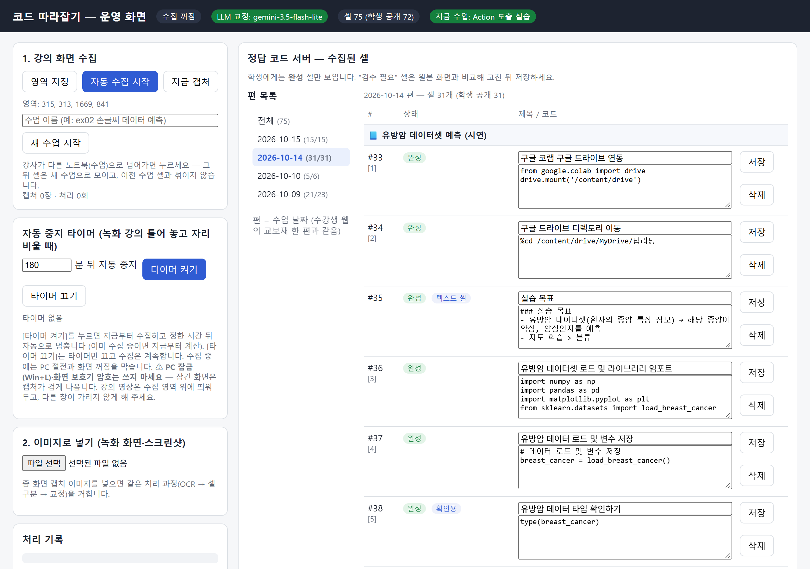 | 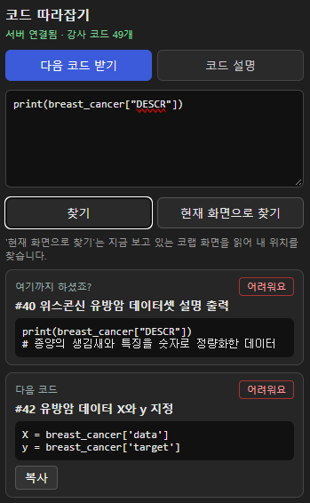 |

| 복습 교보재 (웹 홈) | 데일리 퀴즈 (웹 홈) |
|---|---|
| 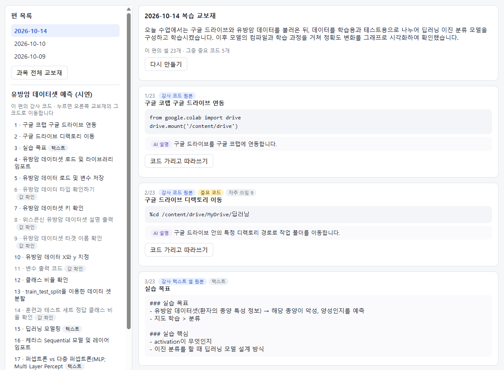 | 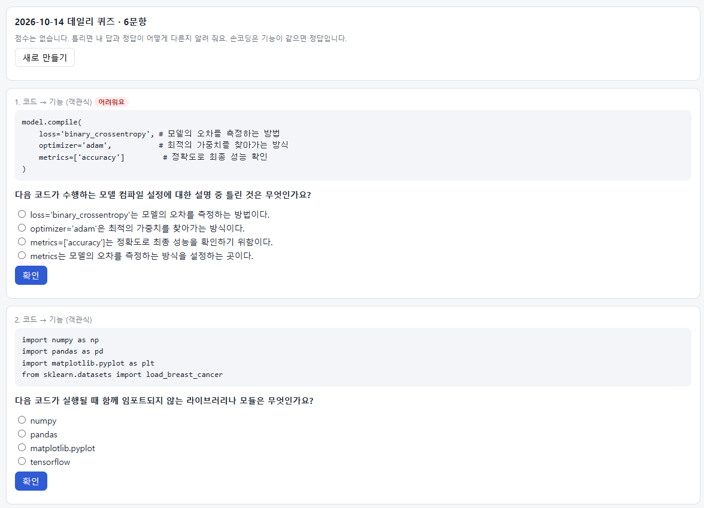 |

<p align="center">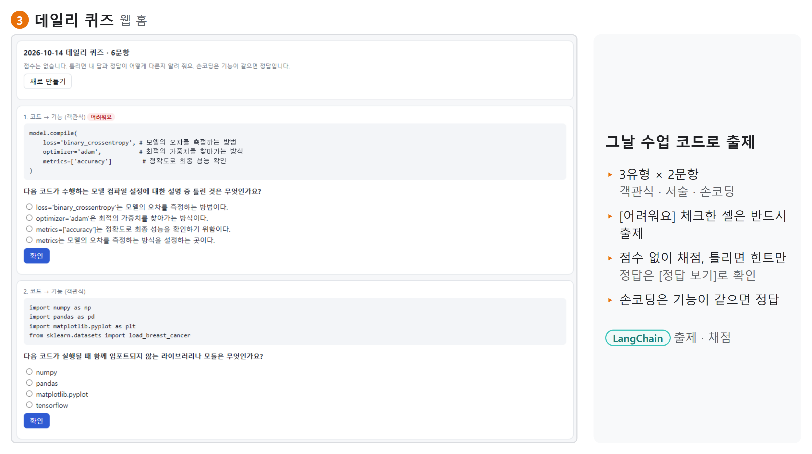</p>

## 🚨 10. 트러블슈팅

- **문제 1. 들여쓰기 정확도가 높게 나왔는데 실제로는 틀렸다**
  - 원인: 지표 착시 — 0칸 줄이 대부분이라 '들여쓰기 일치 90.9%'. 들여쓴 줄만 보면 **17.5%**. 0칸 위치를 '가장 많은 줄이 시작하는 곳'으로 잡아 함수 안 줄이 많으면 −4칸, 짧은 단어 때문에 글자 폭을 작게 재 +1칸.
  - 해결: 0칸 = 여러 줄이 모인 가장 왼쪽 무리(블록 머리 줄 확인), 글자 폭 = 두 단어씩 기울기의 중앙값(Theil–Sen), 들여쓰기 단위(4칸) 배수로 맞춤.
  - 결과: 들여쓴 줄 17.5% → 78.0% (실제 코랩 화면).
- **문제 2. 화면 전체 들여쓰기가 2칸씩 밀렸다**
  - 원인: PaddleOCR이 줄번호와 코드를 한 상자(`19 # 정답…`)로 읽고 넓은 여백을 공백 한 칸으로 처리 → 단어 위치를 글자 수로 나눠 추정하면서 왼쪽으로 몰림.
  - 해결: 줄번호 잉크 뒤 첫 잉크를 코드 시작으로 보고 단어를 다시 펼침(`_unglue_line_number`) + 단어 좌표를 실제 글자 잉크(밝기 160 미만) 경계에 맞춤(`_snap_to_ink`).
  - 결과: 들여쓴 줄 72% → 84%, **규칙을 만들 때 보지 않은 수업 화면에서도** 74.5% → 77.6%.
- **문제 3. AI가 화면에 없는 코드를 지어냈다**
  - 원인: Gemini가 OCR 교정 중 `model2.add(Dense(... input_shape` 같은 줄을 만들어 냄 — 수정량 80% 검사는 통과.
  - 해결: 줄 단위 검사 추가 — 줄 구성은 OCR 기준(LLM이 더한 줄은 버림), OCR 판독에 없던 코드 단어를 넣은 줄은 거절 → '검수 필요'.
  - 결과: 'LLM은 OCR 오류만 고친다'를 프롬프트가 아니라 코드로 보장.
- **문제 4. 엔진을 바꿔 비교했는데 사실 같은 엔진으로 재고 있었다**
  - 원인: 평가 도구가 서버 설정 `config.json`의 `ocr_engine: "hybrid"`를 그대로 따라감.
  - 해결: 평가할 때 엔진을 강제로 지정. "측정 도구도 검증해야 한다".
- **문제 5. PaddleOCR이 한 장에 15초 걸리고 한글을 못 읽었다**
  - 원인: 검출 모델을 지정하면 `lang='korean'`이 무시되고 중국어 인식 모델이 쓰임.
  - 해결: 인식 모델 이름(`korean_PP-OCRv5_mobile_rec`)을 직접 지정, oneDNN 켬 → 1장 약 1.6초(GPU 약 0.2초).
- **문제 6. 치다 만 코드(`data.if`)가 수강생에게 공개됐다**
  - 원인: 강사가 제목 주석을 먼저 쓰고 나중에 코드를 채우는 수업 방식 + 코랩은 셀을 고쳐도 예전 실행번호·출력을 그대로 남김.
  - 해결: 선택된 셀(파란 테두리)은 실행·출력 전까지 미완성, 같은 실행번호로 내용이 다른 셀이 이미 있으면 예전 실행의 흔적으로 판단.
- **문제 7. 완성된 셀이 다른 셀로 덮어써졌다**
  - 원인: 글자 유사도 0.55를 넘는 '확실한 짝'은 실행번호를 보지 않음 → `[3] import mnist`가 `[16] from tensorflow.keras.models import…`에 덮어써짐.
  - 해결: 저장 셀이 완성이고 실행번호가 둘 다 보이는데 다르면, 유사도 0.8 미만은 다른 셀로 봄.
  - 결과: 덮어써졌던 4개 셀 모두 되찾음, 잃은 셀 없음.
- **문제 8. 셀 위에 겹친 카카오톡 채팅창 글자가 코드로 들어갔다**
  - 원인: 강사 화면에 메신저 창이 코랩 셀 위로 겹쳐 뜸.
  - 해결: 중간 밝기 바탕(다른 창)이 일정 크기 이상 덩어리지면 그 안 글자를 빼고, `오전/오후 hh:mm` 글자도 뺌(`_drop_overlay`). 코랩 함수 설명 팝업(바탕 밝기 약 242)도 같은 방식으로 거름.
- **문제 9. 글꼴을 넣은 발표 자료가 PowerPoint에서 '복구'를 요구했다** (문서 작업 도구)
  - 원인: 포함 글꼴의 관계 번호를 하나씩 차례로 바꾸다 이미 바꾼 번호가 또 바뀜(rId66→69 다음 rId69→72).
  - 해결: 정규식으로 한 번에 바꿈(`re.sub` + 대응표).

> 개선 원칙: 사례 하나를 고칠 때마다 **여러 수업 화면으로 전·후를 비교**하고, 전체 오류가 늘면 적용하지 않았다(예: 빠진 `#` 되살리기 규칙 → 주석 오류율 5.7% → 10.4%로 나빠져 끔).

## 📁 프로젝트 구조

```
핵심 프로젝트/
├─ 강의리뷰 분석/                 # 01 페인포인트 · 02 군집 · 03 LDA 노트북, 리뷰_전처리.py
├─ 프로토타입/
│  ├─ server/
│  │  ├─ app.py                  # FastAPI 서버 (운영·수강생 API)
│  │  ├─ collector.py · screen.py # 화면 캡처(mss)·변화 감지
│  │  ├─ layout.py               # 셀 모양 찾기 (괄호·테두리·선택 셀)
│  │  ├─ ocr.py                  # PaddleOCR + 좌표 들여쓰기
│  │  ├─ pipeline.py             # 짝짓기·다수결·완성 판정·저장·검색
│  │  ├─ llm.py                  # LangChain · Gemini (교정·검색·설명·교보재·퀴즈·채점)
│  │  ├─ review.py               # 복습 교보재·데일리 퀴즈
│  │  ├─ db.py · evaluate.py     # SQLite / 정답 노트북 대비 평가
│  │  └─ static/                 # admin.html·admin.js(운영), home.html(수강생 웹)
│  ├─ 사이드패널/                 # 크롬 확장 (manifest v3)
│  ├─ run_server.bat · run_server_gpu.bat · 키등록.bat · run_evaluate.bat
│  └─ 시제품_기능정리.md          # 기능별 판단 기준·오류 대처·측정값·변경 이력
└─ 산출 문서/                      # 기획서, 빅데이터 분석 정의서, DCX 워크시트, 화면설계서, 발표 자료
```

### 실행 방법

1. 패키지: `fastapi uvicorn paddleocr paddlepaddle opencv-python pillow mss langchain langchain-google-genai` <!-- TODO: requirements.txt 만들기 -->
2. Gemini 키: [Google AI Studio](https://aistudio.google.com/apikey)에서 발급 → `키등록.bat` (환경변수 `GOOGLE_API_KEY`). 키가 없으면 규칙만으로 동작.
3. `run_server.bat`(CPU) 또는 `run_server_gpu.bat`(GPU) → 운영 화면 `http://localhost:8765/admin`, 수강생 웹 `http://localhost:8765/home`, API 문서 `http://localhost:8765/docs`
4. 크롬 `chrome://extensions` → 개발자 모드 → [압축해제된 확장 프로그램 로드] → `프로토타입/사이드패널`

> ⚠️ 시제품은 `127.0.0.1`에서만 열리고 학생 구분이 없다(한 PC 시연용). 수집한 화면 이미지·DB(`server/data/`)는 저장소에 올리지 않는다.

## 👥 11. 팀원 역할

| 이름 | 역할 | Main 업무 | Sub 업무 | GitHub |
|---|---|---|---|---|
| 조윤혁 | 팀장 | PM, 기획 | <!-- TODO --> | <!-- TODO --> |
| 김류천 | 팀원 | 데이터 분석, 평가 | <!-- TODO --> | <!-- TODO --> |
| 김현성 | 팀원 | 수집, 인식 파이프라인 | <!-- TODO --> | <!-- TODO --> |
| 배현 | 팀원 | 서비스 화면, 서버, 시연 | <!-- TODO --> | <!-- TODO --> |
| 윤순관 | 팀원 | AI, LangChain | <!-- TODO --> | <!-- TODO --> |

## 🎬 12. 시연 영상

<!-- TODO: 유튜브 등에 올린 뒤 링크와 썸네일 넣기
[](https://youtu.be/영상ID)
-->

## 📚 13. 참고문헌

- **제안 배경**
  - K-디지털 트레이닝 2024년 예산 4,731억 원 — 전자신문, 2023.09.28
  - 2026년 K-디지털 트레이닝 524억 원 추가 편성 — 정책브리핑(고용노동부), 2026.04.24
  - 스마트인재개발원 국비 예산 8억 원(2016) → 100억 원 — AI타임스, 2022.06.28
  - 연 1,500명 이상 배출, 수료생 75% 비전공자 — 기관 발표
- **학습 근거**
  - Craik, Govoni, Naveh-Benjamin & Anderson (1996). The effects of divided attention on encoding and retrieval processes in human memory. *Journal of Experimental Psychology: General*, 125, 159–180. — 들으며 다른 과제를 하면 기억에 저장되지 못함
  - Robins (2010). Learning edge momentum: a new account of outcomes in CS1. *Computer Science Education*, 20(1), 37–71. — 프로그래밍 개념은 연결돼 있어 앞을 놓치면 뒤가 어려움
  - Grinschgl, Papenmeier & Meyerhoff (2021). Consequences of cognitive offloading: Boosting performance but diminishing memory. *Quarterly Journal of Experimental Psychology*, 74, 1477–1496. — 복사 버튼 지연 근거 (패턴 따라 만들기 과제 = 타 분야 결과)
- **데이터**: 스마트인재개발원 제공 수료생 강의 만족도 리뷰(265건), 자체 설문(재학생 43명, 2026.09.10)
